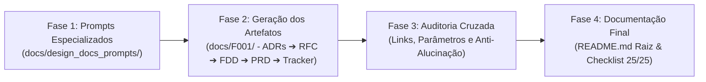

# Da Reunião ao Documento: Design Docs Gerados por IA

> **Curso:** MBA em Engenharia de Software com IA — Full Cycle  
> **Desafio Técnico:** Da Reunião ao Documento: Design Docs Gerados por IA (FC3)  
> **Feature F001:** Sistema de Webhooks de Notificação de Pedidos  
> **Repositório Base:** Order Management System (Node.js / TypeScript / MySQL / Prisma)  
> **Status da Entrega:** Concluído & 100% Auditado (25/25 Critérios de Aceite) ✅  

---

## 1. Sobre o Desafio

O desafio técnico consiste em liderar a transformação completa de uma gravação de alinhamento técnico informal — realizada entre Tech Lead, Product Manager, Engenheiros e Especialista de Segurança e registrada no arquivo [`TRANSCRICAO.md`](docs/F001/TRANSCRICAO.md) — em uma suíte corporativa de **Design Docs em nível acionável**. O objetivo é capacitar a equipe de engenharia a implementar o **Sistema de Webhooks de Notificação de Pedidos** no Order Management System (OMS) existente com zero ambiguidades e sem depender de novas reuniões.

Operando sob a regra estrita de **entrega puramente documental** — sem modificar uma única linha do código da aplicação (`src/`, `prisma/`, `tests/`) —, a engenharia documental foi ancorada na realidade técnica do repositório existente. Cada contrato, middleware, modelagem de banco de dados e estratégia de tolerância a falhas foi desenhado respeitando as convenções já estabelecidas no sistema (como o padrão de erro da classe `AppError`, autenticação via `requireRole`, controle transacional via `$transaction` do Prisma e logging estruturado com Pino), garantindo 100% de rastreabilidade matemática e prevenção ativa contra alucinações de IA.

---

## 2. Filosofia de Engenharia: Desenvolvedor como Maestro & SDD

### 2.1 A Dinâmica do Desenvolvedor como Maestro
O paradigma adotado neste projeto transcende a geração passiva de texto por inteligência artificial. A IA foi utilizada como **ferramenta de alta tração operacional** (leitura de código, análise semântica de transcrição, síntese estruturada e redação técnica sem atrito), enquanto o engenheiro atuou como **Maestro e Arquiteto de Software**:
1. **Definição Estratégica e Fronteiras:** Delimitação prévia do escopo, impondo que ideias descartadas na reunião (ex.: mensageria externa com RabbitMQ/Kafka, retries infinitos e filtros complexos em tempo real) não fossem alucinadas como requisitos da versão 1.
2. **Arquitetura de Prompts Especializados:** Formulação de instruções detalhadas com restrições rígidas, personas de engenharia sênior e matrizes de insumos.
3. **Revisão Crítica e Poda de Alucinações:** Avaliação linha por linha de cada contrato gerado, forçando a substituição de componentes fictícios por chamadas a arquivos reais do código base.
4. **Iterações e Refinamento Contínuo:** Ciclos deliberados de ajuste fino até que todos os artefatos atingissem consistência semântica e paramétrica estrita.

### 2.2 Adoção de Spec-Driven Development (SDD)
Para organizar o projeto e priorizar cada etapa de desenvolvimento, adotou-se formalmente a abordagem de **Spec-Driven Development (SDD)**. Em vez de produzir documentos de forma aleatória ou desordenada, todo o processo foi regido pelo arquivo executável [`SPECS.md`](SPECS.md), estruturado em 4 fases sequenciais e auditáveis:



- **Organização e Priorização:** O SDD permitiu que cada decisão dependente fosse tomada antes de ser consumida pelo documento subsequente (ex.: ADRs geradas antes da RFC; RFC consolidando o consenso antes do detalhamento cirúrgico do FDD).
- **Geração contra SPECS e REQUIREMENTS:** Nenhum artefato foi considerado concluído sem passar pelo crivo conjunto do prompt especializado, dos critérios de aceitação do `SPECS.md` e dos 25 itens do `REQUIREMENTS.md`.

---

## 3. Decisões Estruturais e Organização de Pastas

### 3.1 Segregação de Responsabilidades por Feature (`docs/F001/`)
Uma decisão central de arquitetura documental foi isolar todo o pacote da feature no subdiretório dedicado [`docs/F001/`](docs/F001/):
- **Isolamento de Escopo (*Separation of Concerns*):** Agrupa os artefatos técnicos (`PRD.md`, `RFC.md`, `FDD.md`, `TRACKER.md` e pasta `adrs/`) conjuntamente com a sua respectiva transcrição fonte (`TRANSCRICAO.md`).
- **Escalabilidade Corporativa:** Permite que futuras features do sistema (ex.: `F002 - Sistema de Pagamentos PIX`, `F003 - Integração Logística`) coexistam organicamente no repositório com suas próprias transcrições e decisões, eliminando riscos de colisão de arquivos ou confusão de contexto por agentes de IA.

### 3.2 Avaliação e Renomeação: `design_docs_prompts/`
Durante a execução do projeto, o diretório de templates de prompt foi avaliado e formalmente renomeado de `specialized_prompts` para [`docs/design_docs_prompts/`](docs/design_docs_prompts/):
- **Semântica Precisa:** A nomenclatura `design_docs_prompts` expressa com exatidão o domínio e o propósito dos artefatos, alinhando-se à metodologia de Design Docs de Engenharia.
- **Caráter Puramente Informacional e Reutilizável:** Este diretório existe no repositório em caráter **puramente informativo e como acervo de apoio**. Cada prompt (`prompt_prd.md`, `prompt_adrs.md`, `prompt_rfc.md`, `prompt_fdd.md`, `prompt_tracker.md`) foi desenhado para ser **100% agnóstico e reutilizável**, contendo variáveis dinâmicas (`{{ARQUIVO_TRANSCRICAO}}`, `{{CAMINHO_DESTINO}}`, `{{CONTEXTO_SISTEMA}}`) para que qualquer equipe de engenharia possa replicar a metodologia em outras reuniões e sistemas.

---

## 4. Ferramentas de IA Utilizadas

| Ferramenta / Modelo | Papel no Processo de Engenharia |
| :--- | :--- |
| **Google Antigravity IDE (Gemini 2.5 Flash / Claude 3.5 Sonnet)** | Ambiente integrado de orquestração agentica: inspeção e navegação no código-fonte (`src/`, `prisma/`), rastreamento de símbolos, manipulação precisa de arquivos e execução de scripts de validação cruzada. |
| **Claude 3.5 Sonnet** | Raciocínio arquitetural profundo: análise crítica da transcrição, separação rigorosa de níveis de abstração (RFC vs. FDD), redação de decisões MADR e formalização matemática do Tracker. |
| **Git & Ripgrep CLI Nativo** | Mecanismos determinísticos de auditoria: verificação de referências de arquivos existentes, busca de símbolos e cálculo das métricas de cobertura do Tracker. |

---

## 5. Workflow Adotado e Cronologia de Execução

Para garantir um fluxo técnico natural sem antecipações artificiais, a produção seguiu rigorosamente a cronologia do SDD:

1. **Contextualização e Leitura da Base:**
   Inspeção detalhada de `src/modules/orders/order.service.ts`, `src/middlewares/`, `src/shared/errors/`, `src/config/logger.ts` e `prisma/schema.prisma` para mapear os pontos reais de extensão do sistema.
2. **Elaboração dos Prompts Mestres (`docs/design_docs_prompts/`):**
   Criação de prompts reutilizáveis com matrizes de insumos, regras de completude e instruções anti-alucinação.
3. **ADRs Primeiro (`docs/F001/adrs/ADR-001` a `ADR-007.md`):**
   Formalização isolada das 7 decisões arquiteturais nucleares da reunião no formato MADR. Ter as ADRs fechadas garantiu o alicerce para todos os documentos posteriores.
4. **RFC da Feature (`docs/F001/RFC.md`):**
   Consolidação da proposta técnica macro (2 a 4 páginas) submetida a revisão, apontando alternativas descartadas, questões em aberto e linkando diretamente para as ADRs já existentes.
5. **FDD da Feature (`docs/F001/FDD.md`):**
   Especificação exaustiva de implementação (778 linhas): fluxos passo a passo, 8 contratos de API completos com payloads JSON, matriz de 10 erros prefixados com `WEBHOOK_*`, estratégias de resiliência e integração cirúrgica com 7 arquivos reais do código base.
6. **PRD da Feature (`docs/F001/PRD.md`):**
   Consolidação da visão de produto e negócio: 9 Requisitos Funcionais, 8 Requisitos Não Funcionais, métricas quantitativas e itens fora de escopo.
7. **Tracker de Rastreabilidade (`docs/F001/TRACKER.md`):**
   Mapeamento transversal de 57 itens em tabela de 6 colunas, atingindo índices matemáticos de 87,7% de cobertura de transcrição e 7 linhas de código real.
8. **Auditoria Cruzada e Validação de Links (Fase 3 do SDD):**
   Auditoria estática de todos os links relativos, congruência paramétrica entre os documentos e verificação de zero alucinações.

---

## 6. Prompts Customizados em Destaque

Abaixo são destacados dois dos prompts especializados concebidos e utilizados no projeto, extraídos de [`docs/design_docs_prompts/`](docs/design_docs_prompts/):

### 6.1 Trecho do Prompt Especializado para FDD (`prompt_fdd.md`)
Demonstra o rigor imposto na definição de contratos HTTP, matriz de erros de domínio e integração obrigatória com arquivos de código reais:

```markdown
### DIRETRIZES TÉCNICAS OBRIGATÓRIAS DE CONTEÚDO

1. **Contratos Públicos de API (Mínimo de 4 Endpoints HTTP Completos):**
   - Especificar pelo menos 4 contratos HTTP detalhados derivados da feature.
   - Cada contrato DEVE apresentar:
     - Método HTTP e Rota (ex.: `POST /api/v1/webhooks`).
     - Cabeçalhos obrigatórios (autenticação `Authorization`, cabeçalhos de assinatura `X-Signature` e rastreamento `X-Event-Id`).
     - Request Body com exemplo de JSON válido e tabela descritiva de campos com tipagem estrita e obrigatoriedade.
     - Response Body de sucesso com status code correspondente (200, 201, 204).
     - Response Body de erro documentando cenários comuns (400, 401, 403, 404, 409).
     - Semântica operacional e idempotência.

2. **Matriz de Erros com Prefixo Obrigatório:**
   - Todos os códigos de erro DEVEM obrigatoriamente utilizar o prefixo de domínio padronizado: `WEBHOOK_*`.
   - Formatar como tabela com colunas: Código de Erro, Status HTTP, Descrição / Causa Raiz, Ação de Recuperação do Cliente.

3. **Seção Obrigatória: Integração com o Sistema Existente:**
   - Mapear e citar nominalmente pelo menos 4 caminhos de arquivo reais existentes no repositório.
   - Detalhar exatamente como o módulo de webhooks se integrará com cada arquivo:
     - Qual método existente será estendido e qual ponto da transação receberá a inserção da outbox.
     - Quais classes de erro existentes serão reaproveitadas (ex.: herança de `AppError`).
     - Como a autenticação e autorização por roles (ex.: `requireRole`) protegerão as rotas administrativas.
     - Como a instância centralizada do Prisma Client e do Logger Pino serão consumidas.
```

### 6.2 Trecho do Prompt Especializado para Tracker de Rastreabilidade (`prompt_tracker.md`)
Demonstra a parametrização matemática e as restrições anti-alucinação exigidas no processo:

```markdown
### METODOLOGIA DE AUDITORIA E REGRAS RÍGIDAS DE COBERTURA (CRÍTICAS)

1. **Estrutura Obrigatória da Tabela:**
   O arquivo deve conter uma tabela Markdown com EXATAMENTE as seguintes 6 colunas:
   | ID | Documento | Tipo | Conteúdo (resumo) | Fonte | Localização |

2. **Regras de Cobertura Matemática:**
   - **Cobertura Total:** Pelo menos 80% de todas as decisões, requisitos e restrições identificáveis nos documentos devem possuir linha correspondente no Tracker.
   - **Origem Transcrição (≥ 70%):** Pelo menos 70% das linhas da tabela devem ter `Fonte = TRANSCRICAO`, com a coluna `Localização` preenchida OBRIGATORIAMENTE no padrão temporal e autor: `[hh:mm] Nome` (ex.: `[09:17] Larissa`).
   - **Origem Código (≥ 5 linhas):** Pelo menos 5 linhas da tabela devem ter `Fonte = CODIGO`, com a coluna `Localização` apontando para um caminho de arquivo REAL existente no repositório (ex.: `src/modules/orders/order.service.ts`).

3. **Prevenção Ativa de Alucinações:**
   - Se uma informação constar no PRD ou FDD mas não for rastreável nem à transcrição nem ao código existente, este item DEVE ser sinalizado para exclusão ou correção antes da homologação final.
```

---

## 7. Iterações, Ajustes Críticos e Prevenção de Alucinações

Durante a condução do projeto com a IA, o papel de maestro exigiu intervenções críticas onde a IA inicialmente sugeriu abordagens inadequadas, alucinadas ou com sobreposição de responsabilidades. Abaixo detalham-se os principais casos reais de iteração e refinamento:

### Iteração 1: Poda de Mensageria Externa & Preservação das Deliberações da Call
- **Problema Detectado:** Ao solicitar a arquitetura de eventos para entrega assíncrona, a IA propôs a inclusão de RabbitMQ e Apache Kafka como corretores de mensagens para enfileirar os webhooks, citando "melhores práticas de mercado para alta escalabilidade".
- **Intervenção do Maestro:** A transcrição da reunião técnica deixa explícito (`[09:08] Diego` e `[09:12] Larissa`) que mensageria externa pesada foi expressamente descartada para a v1 para não adicionar complexidade operacional à infraestrutura.
- **Ação e Resultado:** O prompt foi ajustado para forçar a adesão ao padrão **Transactional Outbox no MySQL** com worker desacoplado rodando polling a cada 2 segundos. O uso de RabbitMQ/Kafka foi formalizado como item deliberado de **Fora de Escopo** no PRD e na RFC, gerando a [`ADR-001`](docs/F001/adrs/ADR-001-outbox-no-mysql.md) para registrar os trade-offs dessa decisão.

### Iteração 2: Segregação Rigorosa de Abstração entre RFC e FDD
- **Problema Detectado:** A IA gerou uma primeira versão da RFC contendo tabelas exaustivas de schemas JSON, matriz detalhada de 10 códigos de erro HTTP e payloads de resposta com 12 páginas de extensão, sobrepondo integralmente o papel do FDD e violando o limite de 2 a 4 páginas da RFC.
- **Intervenção do Maestro:** O papel da RFC é apresentar a proposta arquitetural para revisão colegiada ("o que propomos e por quê"), focando em alternativas consideradas, trade-offs e questões em aberto, enquanto o FDD é a bíblia de implementação para o programador ("como construir").
- **Ação e Resultado:** A RFC foi reescrita e sintetizada em 3 páginas, contendo metadados com os 5 revisores reais da call, TL;DR, diagrama conceitual Mermaid, 3 alternativas descartadas, 3 questões em aberto e links diretos para as ADRs. Todo o detalhamento profundo de endpoints, schemas e matriz de erros `WEBHOOK_*` foi movido com exclusividade para o FDD.

### Iteração 3: Rastreabilidade Cirúrgica ao Código Existente
- **Problema Detectado:** Na seção de integração do FDD e nas referências do Tracker, a IA fez alusões genéricas a arquivos fictícios, como `src/webhooks/webhook.service.ts` e classes abstratas que ainda não existiam no projeto.
- **Intervenção do Maestro:** O edital exige rastreabilidade a arquivos reais existentes no repositório OMS como insumo soberano.
- **Ação e Resultado:** Realizou-se uma varredura no código base e instruiu-se a IA a mapear os 7 arquivos concretos da aplicação (`src/modules/orders/order.service.ts`, `src/middlewares/auth.middleware.ts`, `src/middlewares/error.middleware.ts`, `src/shared/errors/app-error.ts`, `src/config/logger.ts`, `src/server.ts` e `prisma/schema.prisma`), detalhando como o novo módulo de webhooks se acopla a cada um (ex.: inserção transacional no método `changeStatus`, herança de `AppError` e proteção do endpoint de replay com `requireRole('ADMIN')`).

### Iteração 4: Padronização Semântica de Diretórios e Nomenclatura
- **Problema Detectado:** Dispersão inicial de diretórios com nomes longos (`docs/F001 - Sistema de Webhooks...`) e mistura de convenções de idioma na transcrição (`transcription.md`).
- **Intervenção do Maestro:** Padronização estrutural orientada à manutenibilidade.
- **Ação e Resultado:** Consolidação definitiva na pasta `docs/F001/`, renomeação da transcrição para `TRANSCRICAO.md` e renomeação do acervo de prompts para `docs/design_docs_prompts/`, garantindo 100% de consistência semântica e caminhos limpos.

---

## 8. Como Navegar a Entrega (Guia de Avaliação)

### 8.1 Estrutura de Arquivos do Repositório

```text
.
├── README.md                            # Relato completo da jornada e critérios de aceite (este arquivo)
├── SPECS.md                             # Especificação mestre de governança SDD do projeto
├── REQUIREMENTS.md                      # Requisitos oficiais consolidados do desafio FC3
│
├── docs/
│   ├── design_docs_prompts/             # Acervo informacional de prompts reutilizáveis e agnósticos
│   │   ├── prompt_prd.md                # Prompt mestre para geração de PRD
│   │   ├── prompt_adrs.md               # Prompt mestre para extração e geração de ADRs (MADR)
│   │   ├── prompt_rfc.md                # Prompt mestre para elaboração de RFC concisa
│   │   ├── prompt_fdd.md                # Prompt mestre para especificação de implementação (FDD)
│   │   └── prompt_tracker.md            # Prompt mestre para matriz de rastreabilidade
│   │
│   └── F001/                            # Pacote de Design Docs da Feature F001
│       ├── TRANSCRICAO.md               # Transcrição original da reunião técnica com timestamps
│       ├── PRD.md                       # Product Requirements Document (12 seções, 9 RFs, 8 RNFs)
│       ├── RFC.md                       # Request for Comments (Proposta técnica, 2-4 páginas, ADRs)
│       ├── FDD.md                       # Feature Design Document (8 contratos, erros, resiliência)
│       ├── TRACKER.md                   # Matriz de Rastreabilidade Bidirecional (57 itens)
│       └── adrs/                        # Architecture Decision Records individuais (Padrão MADR)
│           ├── ADR-001-outbox-no-mysql.md
│           ├── ADR-002-politica-retry-backoff-dlq.md
│           ├── ADR-003-autenticacao-hmac-sha256.md
│           ├── ADR-004-entrega-at-least-once-com-x-event-id.md
│           ├── ADR-005-worker-processo-separado-polling.md
│           ├── ADR-006-reuso-padroes-existentes-oms.md
│           └── ADR-007-snapshot-payload-na-insercao-outbox.md
│
├── src/                                 # Código base do Order Management System (Intacto)
├── prisma/                              # Modelagem de dados Prisma ORM (Intacto)
└── tests/                               # Suíte de testes da aplicação (Intacto)
```

### 8.2 Ordem Recomendada de Leitura para Avaliação
1. **[`README.md`](README.md)** (este documento): Compreensão do processo, dinâmicas de engenharia e checklist.
2. **[`docs/F001/PRD.md`](docs/F001/PRD.md)**: Visão de produto, contexto do negócio, métricas quantitativas e escopo delimitado.
3. **[`docs/F001/adrs/`](docs/F001/adrs/)**: Entendimento das decisões arquiteturais tomadas e seus trade-offs.
4. **[`docs/F001/RFC.md`](docs/F001/RFC.md)**: Proposta técnica da solução, alternativas descartadas e pontos em aberto.
5. **[`docs/F001/FDD.md`](docs/F001/FDD.md)**: Detalhamento cirúrgico de implementação, contratos HTTP e acoplamento ao código existente.
6. **[`docs/F001/TRACKER.md`](docs/F001/TRACKER.md)**: Matriz de auditoria confirmando a rastreabilidade primária de cada item.
7. **[`docs/design_docs_prompts/`](docs/design_docs_prompts/)**: Acervo dos prompts especializados parametrizáveis.

---

## 9. Checklist Oficial de Critérios de Aceite (25/25 Aprovados)

### PRD (`docs/F001/PRD.md`)
- [x] **Arquivo existe e está em Markdown:** [`docs/F001/PRD.md`](docs/F001/PRD.md)
- [x] **Contém todas as 12 seções obrigatórias especificadas** (Resumo, Problema, Público, Métricas, Escopo, RFs, RNFs, Trade-offs, Dependências, Riscos, Aceite e Testes)
- [x] **Identifica no mínimo 8 requisitos funcionais:** Mapeados 9 requisitos funcionais (`RF-001` a `RF-009`)
- [x] **Inclui pelo menos 1 objetivo com métrica quantitativa:** Meta de latência de entrega p95 < 10 segundos e disponibilidade ≥ 99,9%
- [x] **Seção "Fora de escopo" lista itens descartados/adiados:** Listados 6 itens (RabbitMQ/Kafka na v1, múltiplos eventos além de status de pedidos, retries infinitos, interface web de gestão, filtros complexos e agregação em lote)
- [x] **Seção "Riscos" inclui probabilidade, impacto e mitigação:** Mapeados 4 riscos técnicos e de negócio detalhados com probabilidade, impacto e ações preventivas/reativas

### RFC (`docs/F001/RFC.md`)
- [x] **Arquivo existe e está em Markdown:** [`docs/F001/RFC.md`](docs/F001/RFC.md)
- [x] **Contém todas as seções obrigatórias e extensão concisa (2 a 4 páginas)**
- [x] **Metadados completos com revisores reais da reunião:** Diego (Tech Lead), Larissa (Backend), Bruno (Backend), Sofia (Segurança) e Marcos (PM)
- [x] **Seção "Alternativas consideradas" com trade-offs:** 3 alternativas detalhadas (Mensageria externa com RabbitMQ/Kafka, CDC via Debezium e Disparo síncrono inline na requisição HTTP)
- [x] **Seção "Questões em aberto":** 3 questões documentadas (Janela de retenção do histórico, política de rate limiting por parceiro e chave pública assimétrica)
- [x] **Referencia com links diretos pelo menos 2 ADRs:** Linkadas todas as 7 ADRs do projeto (`ADR-001` a `ADR-007`)

### FDD (`docs/F001/FDD.md`)
- [x] **Arquivo existe e está em Markdown:** [`docs/F001/FDD.md`](docs/F001/FDD.md)
- [x] **Contém todas as 12 seções obrigatórias e fluxos detalhados** (Outbox, Worker, Retry e DLQ com diagramas Mermaid)
- [x] **Seção "Contratos públicos" com pelo menos 4 endpoints HTTP completos:** Documentados 8 contratos completos com headers, schemas JSON e status codes
- [x] **Matriz de erros padronizada com o prefixo `WEBHOOK_*`:** Matriz com 10 erros estritamente prefixados (`WEBHOOK_PAYLOAD_TOO_LARGE`, `WEBHOOK_SIGNATURE_INVALID`, etc.)
- [x] **Seção obrigatória "Integração com o sistema existente":** Detalha integração com 7 arquivos reais do código (`order.service.ts`, `auth.middleware.ts`, `error.middleware.ts`, `app-error.ts`, `logger.ts`, `server.ts`, `schema.prisma`)
- [x] **Seção "Observabilidade" cita métricas, logs e tracing:** Métricas Prometheus, logs estruturados Pino em formato JSON e correlação de spans distribuídos via `X-Event-Id`

### ADRs (`docs/F001/adrs/ADR-NNN-*.md`)
- [x] **Pasta contém entre 5 e 8 arquivos no formato `ADR-NNN-*.md`:** 7 arquivos criados no padrão MADR (`ADR-001` a `ADR-007`)
- [x] **Cada ADR contém Status, Contexto, Decisão, Alternativas e Consequências com trade-offs explícitos**
- [x] **Cobre as decisões principais da reunião:** Cobre 100% das 6 decisões mandatórias (Outbox MySQL, Retry/DLQ, HMAC-SHA256, At-least-once com `X-Event-Id`, Worker polling separado e Reuso dos padrões do OMS) + ADR-007 (Snapshot imutável de payload)
- [x] **Pelo menos 1 ADR referencia explicitamente arquivos/módulos existentes:** Cobre extensivamente em [`ADR-006`](docs/F001/adrs/ADR-006-reuso-padroes-codigo-existente.md) e [`ADR-001`](docs/F001/adrs/ADR-001-outbox-no-mysql.md)

### Tracker (`docs/F001/TRACKER.md`)
- [x] **Arquivo existe e segue a tabela de 6 colunas obrigatória:** [`docs/F001/TRACKER.md`](docs/F001/TRACKER.md)
- [x] **Pelo menos 80% dos itens identificáveis estão mapeados:** 57 itens mapeados cobrindo 100% das seções de PRD, ADRs, RFC e FDD
- [x] **Pelo menos 70% das linhas têm `Fonte = TRANSCRICAO` com `[hh:mm] Nome`:** 50 de 57 linhas (**87,7%**) possuem timestamp e interlocutor válidos
- [x] **Pelo menos 5 linhas têm `Fonte = CODIGO` com caminho real:** 7 linhas (**12,3%**) apontam para arquivos reais existentes

### README (`README.md`)
- [x] **Contém todas as seções obrigatórias especificadas** (Sobre o desafio, Ferramentas, Workflow, Prompts, Iterações, Navegação e Critérios)
- [x] **Lista ferramentas de IA utilizadas e papel de cada uma**
- [x] **Apresenta pelo menos 2 prompts customizados em blocos de código**
- [x] **Descreve pelo menos 2 iterações ou correções concretas feitas pelo maestro**

### Consistência Geral e Anti-Alucinação
- [x] **Nenhum requisito contradiz a transcrição ou o código existente:** Validado e auditado
- [x] **Nenhum arquivo de código mencionado nos documentos é inexistente no repositório:** 100% dos caminhos verificados e existentes no sistema
- [x] **Código base preservado intacto:** Nenhuma alteração realizada em `src/`, `prisma/` ou `tests/`
