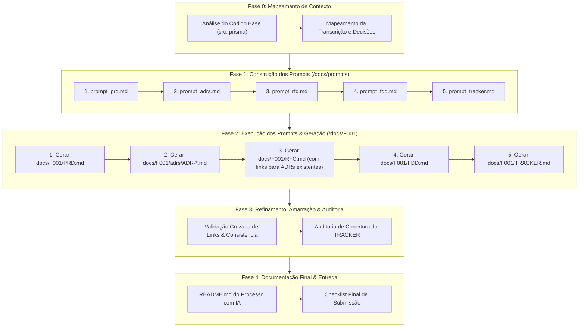

# SPECS.md — Especificação e Plano Mestre de Execução (Design Docs com IA)

> **Projeto:** Full Cycle 3 — Da Reunião ao Documento: Design Docs Gerados por IA  
> **Feature F001:** Sistema de Webhooks de Notificação de Pedidos (OMS)  
> **Status Geral:** Concluído & 100% Auditado (Fases 1, 2, 3 e 4) ✅  
> **Última Atualização:** 2026-10-11  

---

## 1. Visão Geral e Objetivo

O objetivo deste projeto é transformar a gravação de alinhamento técnico transcrita em [`TRANSCRICAO.md`](docs/F001/TRANSCRICAO.md) e o código base existente em um pacote profissional e acionável de **Design Docs** de engenharia de software para o **Sistema de Webhooks de Notificação de Pedidos**.

A estratégia é orientada a **Engenharia de Prompts Especializados**:
1. Desenvolver prompts estruturados e reutilizáveis (um para cada tipo de documento), contendo o papel do documento, modelo canônico, regras estritas de não-alucinação e seções mandatórias.
2. Executar os prompts sequencialmente fornecendo a transcrição e o contexto do repositório como entrada.
3. Revisar, refinar e validar cada documento contra os critérios de aceite e rastreabilidade definidos em [`REQUIREMENTS.md`](REQUIREMENTS.md).

---

## 2. Diretrizes Inegociáveis e Limites do Projeto

> [!CAUTION]
> **Proibição Estrita de Modificação de Código:**  
> É **terminantemente vedado alterar arquivos de código da aplicação** (`src/`, `prisma/`, `tests/` ou configurações de build/docker). Todo o esforço deste projeto é estritamente documental e analítico. O código serve exclusivamente como insumo de contexto e integração.

> [!IMPORTANT]
> **Rastreabilidade Bidirecional e Anti-Alucinação:**  
> Qualquer requisito, decisão arquitetural, restrição, endpoint ou payload deve ter origem comprovável na [`TRANSCRICAO.md`](docs/F001/TRANSCRICAO.md) (com timestamp `[hh:mm] Nome`) ou no código-fonte da aplicação (com caminho real de arquivo). Não inventar requisitos inexistentes.

> [!WARNING]
> **Fronteira Rígida de Escopo (O que NÃO entra):**  
> Identificar o que **não faz parte da V1** ou o que foi **descartado/adiado** na reunião é crucial (ex.: mensageria externa pesada Redis Streams/Kafka/RabbitMQ, notificações por e-mail, dashboard visual, rate limiting de envio imediato, ordering global multi-worker). Itens descartados/adiados não devem ser descritos como entregáveis da feature.

---

## 3. Estrutura de Diretórios e Nomenclatura

```text
.
├── SPECS.md                         # Guia mestre e checklist do projeto (este arquivo)
├── REQUIREMENTS.md                  # Requisitos oficiais consolidados do desafio
├── TRANSCRICAO.md                   # Transcrição da reunião técnica (fonte primária)
├── README.md                        # Relatório final da jornada com IA (substituirá o original)
│
├── docs/
│   ├── design_docs_prompts/         # Prompts especializados para geração de cada artefato
│   │   ├── prompt_prd.md            # Prompt para geração do PRD
│   │   ├── prompt_adrs.md           # Prompt para geração das ADRs
│   │   ├── prompt_rfc.md            # Prompt para geração da RFC
│   │   ├── prompt_fdd.md            # Prompt para geração do FDD
│   │   └── prompt_tracker.md        # Prompt para geração do Tracker
│   │
│   └── F001/                        # Artefatos gerados da Feature de Webhooks
│       ├── TRANSCRICAO.md           # Cópia local da transcrição da reunião
│       ├── PRD.md                   # Product Requirements Document
│       ├── adrs/                    # Architecture Decision Records (geradas antes da RFC)
│       │   ├── ADR-001-outbox-no-mysql.md
│       │   ├── ADR-002-politica-retry-backoff-dlq.md
│       │   ├── ADR-003-autenticacao-hmac-sha256.md
│       │   ├── ADR-004-entrega-at-least-once-idempotencia.md
│       │   ├── ADR-005-worker-processo-separado-polling.md
│       │   ├── ADR-006-reuso-padroes-codigo-existente.md
│       │   └── ADR-007-snapshot-payload-insercao-outbox.md (opcional/adicional)
│       ├── RFC.md                   # Request for Comments (com links para as ADRs)
│       ├── FDD.md                   # Feature Design Document
│       └── TRACKER.md               # Matriz de Rastreabilidade
│
├── src/                             # Código base existente (apenas leitura / contexto)
├── prisma/                          # Modelagem de dados atual (apenas leitura / contexto)
└── examples/PRD/                    # Exemplos de PRD fornecidos pelo curso (referência)
```

> **Nota de Alinhamento de Diretórios:** O repositório base foi inicializado com a pasta `docs/F001 - Sistema de Webhooks de Notificação de Pedidos/`. Para garantir uniformidade com a instrução do projeto (`/docs/F001`), os artefatos serão direcionados para `docs/F001/` (ou mapeados como padrão consensual).

---

## 4. Cronologia e Checklist de Desenvolvimento

A cronologia segue uma abordagem estruturada em 4 macrofases sequenciais:



---

### Fase 0: Mapeamento de Contexto e Extração Primária
- [x] Mapear entidades do `prisma/schema.prisma` (`Order`, `Customer`, `UserRole`, `OrderStatus`, etc.). ✅
- [x] Mapear arquivos-chave em `src/` para integração futura: ✅
  - `src/modules/orders/order.service.ts` (`changeStatus`, controle de transação `prisma.$transaction`).
  - `src/middlewares/auth.middleware.ts` e `requireRole`.
  - `src/middlewares/error.middleware.ts`.
  - `src/shared/errors/app-error.ts` e classes de erro de domínio.
  - `src/config/logger.ts` (Pino).
  - `src/server.ts` (modelo de inicialização para o futuro `src/worker.ts`).
- [x] Catalogar participantes da call: Larissa (Tech Lead), Marcos (PM), Bruno (Eng. Pedidos), Diego (Eng. Plataforma), Sofia (Segurança). ✅
- [x] Catalogar decisões, números e prazos: ✅
  - Latência aceitável < 10s (polling worker a cada 2s).
  - Backoff: 5 tentativas (1m, 5m, 30m, 2h, 12h) -> DLQ em tabela separada.
  - Replay de DLQ: endpoint restrito a `ADMIN`.
  - HMAC-SHA256: secret por endpoint, rotação com 24h de transição, payload max 64KB, HTTPS obrigatório.
  - Headers: `X-Event-Id` (UUID, idempotência/dedup), `X-Signature`, `X-Timestamp`, `X-Webhook-Id`.
  - Prazo: 3 sprints (meta: fim de novembro, revisão de 2 dias úteis com Sofia).

---

### Fase 1: Criação dos Prompts Especializados (`docs/design_docs_prompts/`)

Nesta fase focaremos na engenharia de cada prompt individual antes de rodar a geração dos documentos, em ordem natural e fluida:

- [x] **1.1 Prompt de PRD (`docs/design_docs_prompts/prompt_prd.md`)**
  - Papel: Definir requisitos de produto, problema, objetivos, métricas quantitativas, público e escopo.
  - Critérios embutidos no prompt:
    - Seguir padrão dos templates em `examples/PRD/`.
    - Conter todas as 12 seções mandatórias do `REQUIREMENTS.md`.
    - Mínimo de 8 Requisitos Funcionais extraídos da reunião.
    - Pelo menos 1 métrica quantitativa clara (ex: latência p95 de entrega < 10s, disponibilidade, etc.).
    - Seção "Fora de Escopo" com no mínimo 2 itens descartados/adiados (e-mails, dashboard visual, rate limiting de saída).
    - Mínimo de 2 riscos com probabilidade, impacto e mitigação.
    - Regras estritas de anti-alucinação e não-ocultação de seções.
  - Status: *Concluído* ✅

- [x] **1.2 Prompt de ADRs (`docs/design_docs_prompts/prompt_adrs.md`)**
  - Papel: Registrar decisões arquiteturais individuais e isoladas no formato MADR antes da proposta geral da RFC.
  - Critérios embutidos no prompt:
    - Agnóstico e reutilizável com parâmetros dinâmicos (`{{ARQUIVO_TRANSCRICAO}}`, `{{DIRETORIO_DESTINO}}`, `{{CONTEXTO_SISTEMA}}`).
    - Tabela de observações críticas sobre o conteúdo esperado na transcrição.
    - Formato padrão MADR (Status, Contexto, Decisão, Alternativas Consideradas, Consequências, Integração/Rastreabilidade).
    - Pelo menos 1 alternativa real descartada com motivo técnico do descarte.
    - Trade-offs e consequências explícitas (positivas e negativas).
    - Pelo menos 1 ADR referenciando diretamente arquivos/classes do código base.
  - Status: *Concluído* ✅

- [x] **1.3 Prompt de RFC (`docs/design_docs_prompts/prompt_rfc.md`)**
  - Papel: Proposta arquitetural concisa (2 a 4 páginas) para discussão e revisão da equipe, integrando as decisões já registradas nas ADRs.
  - Critérios embutidos no prompt:
    - Agnóstico e reutilizável com parâmetros dinâmicos (`{{ARQUIVO_TRANSCRICAO}}`, `{{CAMINHO_DESTINO}}`, `{{DIRETORIO_ADRS}}`, `{{CONTEXTO_SISTEMA}}`).
    - Tabela de observações críticas sobre o conteúdo esperado na transcrição.
    - Metadados com revisores extraídos da transcrição.
    - Resumo executivo (TL;DR) e proposta técnica conceitual com diagrama Mermaid.
    - No mínimo 2 alternativas reais descartadas com análise de trade-offs.
    - No mínimo 2 questões técnicas em aberto ou pontos futuros.
    - Links diretos para no mínimo 2 ADRs já consolidadas no pacote.
    - Regra estrita de não-ocultação de seções.
  - Status: *Concluído* ✅

- [x] **1.4 Prompt de FDD (`docs/design_docs_prompts/prompt_fdd.md`)**
  - Papel: Especificação técnica profunda e acionável para o desenvolvedor codificar.
  - Critérios embutidos no prompt:
    - Agnóstico e reutilizável com parâmetros dinâmicos (`{{ARQUIVO_TRANSCRICAO}}`, `{{CAMINHO_DESTINO}}`, `{{ARQUIVO_PRD}}`, `{{DIRETORIO_ADRS}}`, `{{CONTEXTO_SISTEMA}}`).
    - Tabela de observações críticas sobre o conteúdo esperado na transcrição e no código.
    - Fluxos detalhados: criação do evento na outbox, ciclo do worker de polling, política de retry e migração para DLQ (diagramas Mermaid).
    - Contratos de API: no mínimo 4 endpoints HTTP completos com request/response JSON e status codes.
    - Matriz de erros padronizada com prefixo de domínio específico (`[DOMINIO]_*`).
    - Resiliência e observabilidade (timeouts, backoff, métricas, logs estruturados em JSON, tracing).
    - Seção mandatória de integração nomeando e integrando no mínimo 4 arquivos reais do código base.
    - Regra estrita de não-ocultação de seções.
  - Status: *Concluído* ✅

- [x] **1.5 Prompt do TRACKER (`docs/design_docs_prompts/prompt_tracker.md`)**
  - Papel: Matriz bidirecional de rastreabilidade para auditoria e controle de alucinações.
  - Critérios embutidos no prompt:
    - Agnóstico e reutilizável com parâmetros dinâmicos (`{{ARQUIVO_TRANSCRICAO}}`, `{{DIRETORIO_DOCUMENTOS}}`, `{{CAMINHO_DESTINO}}`, `{{CONTEXTO_SISTEMA}}`).
    - Tabela de observações críticas sobre o conteúdo esperado na transcrição e no código.
    - Estrutura de tabela com 6 colunas estritas: `| ID | Documento | Tipo | Conteúdo (resumo) | Fonte | Localização |`.
    - IDs padronizados (`PRD-FR-*`, `ADR-00*`, `RFC-PROP-*`, `RFC-ALT-*`, `FDD-CTR-*`, etc.).
    - Auditoria matemática de cobertura: ≥ 80% do total de itens dos docs, ≥ 70% com `[hh:mm] Nome` (`TRANSCRICAO`) e ≥ 5 linhas apontando para caminhos reais de código base (`CODIGO`).
    - Resumo estatístico de conformidade da auditoria ao final.
  - Status: *Concluído* ✅

---

### Fase 2: Execução dos Prompts e Geração dos Documentos Técnicos (`docs/F001/`)

Execução sequencial dos prompts gerados, garantindo que cada documento se apoie nos artefatos precedentes:

- [x] **2.1 Execução do Prompt PRD -> `docs/F001/PRD.md`**
  - Executar prompt usando `TRANSCRICAO.md` e referências de produto.
  - Revisar seções: problema, personas, métricas quantitativas, escopo (incluso/excluso), 8+ requisitos funcionais, riscos e estratégias de teste.
  - Status: *Concluído* ✅

- [x] **2.2 Execução do Prompt ADRs -> `docs/F001/adrs/ADR-001` a `ADR-007.md`**
  - Executar prompt gerando entre 5 e 8 arquivos `.md` individuais (7 ADRs geradas).
  - Validar estrutura MADR e cobrir as decisões de outbox, retry/DLQ, HMAC, idempotência, worker isolado e arquitetura modular existente.
  - Status: *Concluído* ✅

- [x] **2.3 Execução do Prompt RFC -> `docs/F001/RFC.md`**
  - Executar prompt combinando `PRD.md`, as ADRs recém-geradas e `docs/F001/TRANSCRICAO.md`.
  - Garantir extensão entre 2 e 4 páginas, tom de proposta técnica aberta, alternativas descartadas, questões em aberto e links diretos para os arquivos de ADRs existentes.
  - Status: *Concluído* ✅

- [x] **2.4 Execução do Prompt FDD -> `docs/F001/FDD.md`**
  - Executar prompt combinando `PRD.md`, `RFC.md`, as ADRs, `docs/F001/TRANSCRICAO.md` e código existente (`src/`, `prisma/schema.prisma`).
  - Validar detalhamento dos 4+ contratos HTTP, matriz com códigos `WEBHOOK_*`, estratégias de backoff e os 4+ arquivos reais de integração.
  - Status: *Concluído* ✅

- [x] **2.5 Execução do Prompt TRACKER -> `docs/F001/TRACKER.md`**
  - Compilar todos os IDs de requisitos funcionais, decisões das ADRs, alternativas da RFC e contratos do FDD (57 itens rastreados).
  - Mapear cada linha com timestamp `[hh:mm] Nome` ou caminho de arquivo real do repositório.
  - Validar índices de cobertura (87,7% transcrição, 7 linhas código, 100% elementos dos docs).
  - Status: *Concluído* ✅

---

### Fase 3: Amarração Cruzada e Auditoria de Consistência
- [x] **Validação de Links Cruzados:** Garantir que links da RFC (`docs/F001/RFC.md`) para as ADRs (`adrs/ADR-*.md`) funcionem perfeitamente. ✅
- [x] **Consistência Semântica:** Verificar se nomes de tabelas (`webhook_outbox`, `webhook_dead_letter`), payloads e nomes de headers (`X-Event-Id`, `X-Signature`, etc.) estão 100% alinhados entre PRD, ADRs, RFC e FDD. ✅
- [x] **Auditoria de Anti-Alucinação:** Checar se nenhum arquivo inventado foi referenciado e se nenhum requisito descartado na call foi colocado como requisito da v1. ✅
- [x] **Auditoria Numérica do Tracker:** Conferir proporções de linhas da transcrição e do código. ✅

---

### Fase 4: Documentação do Processo e Preparação de Entrega
- [x] **Geração do `README.md` Raiz:**
  - Substituir o README do boilerplate pelo relato detalhado da jornada de engenharia com IA. ✅
  - Descrição da dinâmica de maestro (definição, revisão crítica, iterações e refinamento). ✅
  - Ferramentas de IA utilizadas e papel de cada uma. ✅
  - Workflow adotado (cronologia de prompts e geração: PRD -> ADRs -> RFC -> FDD -> TRACKER). ✅
  - Blocos de código com pelo menos 2 prompts customizados reais. ✅
  - Pelo menos 2 iterações concretas relatando correções de alucinações ou aprofundamento técnico. ✅
  - Guia de navegação completo para os avaliadores. ✅
- [x] **Checklist de Aceite Final:** Revisão de todos os 25 itens do checklist oficial de `REQUIREMENTS.md`. ✅

---

## 5. Matriz de Acompanhamento e Critérios de Aceite

### 5.1 Prompts Especializados (`docs/design_docs_prompts/`)

| Prompt | Caminho | Características e Regras Embutidas | Status |
| :--- | :--- | :--- | :--- |
| **Prompt PRD** | `docs/design_docs_prompts/prompt_prd.md` | Agnóstico e reutilizável; parâmetros dinâmicos; 12 seções; 8+ RFs (`RF-00X`); RNFs (`RNF-00X`); tabela de insumos esperados e fallback sem ocultação de seções. | ✅ Concluído |
| **Prompt ADRs** | `docs/design_docs_prompts/prompt_adrs.md` | Agnóstico e reutilizável; parâmetros dinâmicos; formato MADR; decisões autônomas; alternativas descartadas; trade-offs; referências ao código base. | ✅ Concluído |
| **Prompt RFC** | `docs/design_docs_prompts/prompt_rfc.md` | Agnóstico e reutilizável; parâmetros dinâmicos; 2 a 4 páginas; TL;DR; diagrama conceitual; alternativas descartadas; questões em aberto; links para ADRs existentes. | ✅ Concluído |
| **Prompt FDD** | `docs/design_docs_prompts/prompt_fdd.md` | Agnóstico e reutilizável; parâmetros dinâmicos; 12 seções; 4+ contratos HTTP completos; matriz de erros prefixada; fluxos Mermaid; 4+ caminhos reais de código base. | ✅ Concluído |
| **Prompt TRACKER** | `docs/design_docs_prompts/prompt_tracker.md` | Agnóstico e reutilizável; tabela 6 colunas; IDs padronizados; painel estatístico; cobertura ≥ 80% total, ≥ 70% transcrição, ≥ 5 linhas código. | ✅ Concluído |

### 5.2 Artefatos Gerados da Feature (`docs/F001/`)

| Documento | Caminho | Regras Críticas Obrigatórias | Status |
| :--- | :--- | :--- | :--- |
| **PRD** | `docs/F001/PRD.md` | 12 seções; ≥ 8 Requisitos Funcionais; ≥ 1 meta quantitativa; ≥ 2 fora de escopo; ≥ 2 riscos com probabilidade/impacto. | ✅ Concluído |
| **ADRs** | `docs/F001/adrs/ADR-*.md` | 5 a 8 arquivos MADR; cobrir ≥ 5 das 6 decisões nucleares da call; ≥ 1 ADR com referência explícita a arquivos/módulos existentes. | ✅ Concluído |
| **RFC** | `docs/F001/RFC.md` | 2 a 4 páginas; revisores reais da call; TL;DR; ≥ 2 alternativas descartadas com trade-offs; ≥ 2 questões em aberto; links para ≥ 2 ADRs existentes. | ✅ Concluído |
| **FDD** | `docs/F001/FDD.md` | Fluxos de outbox/worker/retry/DLQ; ≥ 4 contratos HTTP completos com payloads; matriz de erros prefixada `WEBHOOK_*`; ≥ 4 caminhos reais de código base; observabilidade. | ✅ Concluído |
| **TRACKER** | `docs/F001/TRACKER.md` | Tabela com 6 colunas; ≥ 80% de cobertura de itens; ≥ 70% com `[hh:mm] Nome`; ≥ 5 com caminho real de código. | ✅ Concluído |
| **README** | `README.md` | Jornada do processo; ferramentas de IA; workflow; ≥ 2 prompts em blocos de código; ≥ 2 iterações/correções documentadas; guia de navegação. | ✅ Concluído |

---

## 6. Pontos de Atenção e Decisões de Alinhamento

1. **Caminho da Pasta de Artefatos:**  
   - O projeto possui `docs/F001 - Sistema de Webhooks de Notificação de Pedidos/`.  
   - Definido pelo usuário: direcionar para `/docs/F001`. Manteremos a padronização alinhada para evitar arquivos duplicados ou referências quebradas.
2. **Fluxo Natural (ADRs antes da RFC):**  
   - Ao gerar as ADRs antes da RFC, garantimos um fluxo 100% natural e sem antecipações artificiais: as decisões arquiteturais pontuais (`ADR-001` a `ADR-00N`) já estarão consolidadas e salvas no diretório `adrs/`, permitindo que a RFC linke diretamente para os arquivos reais existentes, e que o FDD posterior se baseie em ambas.
3. **Insumo de Código Obrigatório:**  
   - Embora o arquivo `TRANSCRICAO.md` contenha as discussões, o código em `src/` e `prisma/schema.prisma` é insumo obrigatório para FDD (4 caminhos de arquivo), ADRs e TRACKER (mínimo de 5 linhas).
