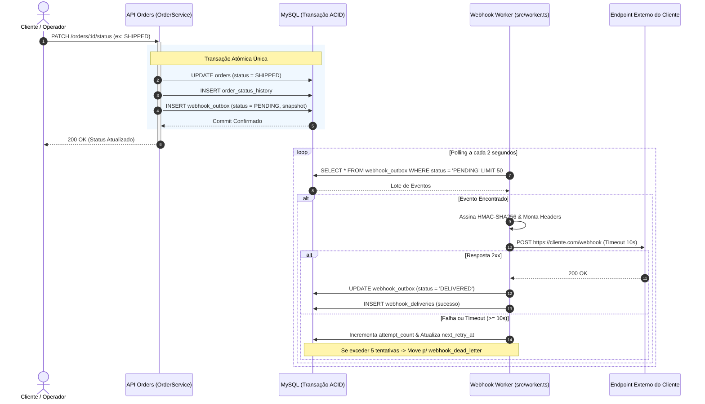

# PRD — Product Requirements Document: Sistema de Webhooks de Notificação de Pedidos

**Versão:** 1.0  
**Data:** 2026-10-11  
**Status:** Aprovado  
**Autores/Responsáveis:** Marcos (Product Manager), Larissa (Tech Lead)  

---

### 1. Resumo da Feature

O **Sistema de Webhooks de Notificação de Pedidos** é uma solução de comunicação assíncrona orientada a eventos (*outbound webhooks*), projetada para notificar sistemas externos de clientes parceiros em tempo real sempre que o status de um pedido for alterado no Order Management System (OMS).

Atualmente, clientes estratégicos do modelo B2B dependem de consultas repetitivas e frequentes (*polling*) no endpoint `GET /orders` para identificar atualizações no ciclo de vida dos pedidos. Essa dinâmica gera sobrecarga desnecessária na infraestrutura do OMS, atrasos no processamento logístico e atrito operacional. A nova funcionalidade substitui esse modelo ineficiente por um mecanismo ativo de disparo HTTP POST assinado e resiliente, garantindo que eventos de transição de status (como aprovação de pagamento, despacho e entrega) cheguem aos clientes em menos de 10 segundos.

A funcionalidade é desenhada com foco em confiabilidade corporativa, utilizando o padrão arquitetural Transacional Outbox para assegurar que nenhum evento seja perdido em caso de falhas transitórias, garantindo consistência atômica com o banco de dados principal e desacoplamento operacional entre o serviço de pedidos e o tráfego externo.

---

### 2. Contexto e Problema

#### Motivação e Importância
Três grandes clientes corporativos B2B — **Atlas Comercial**, **MaxDistribuição** e **Nova Cargo** — solicitaram formalmente a integração via webhooks para sincronizar automaticamente seus sistemas internos (ERPs e WMSs) com o OMS da companhia. A dependência atual de rotinas de polling eleva o custo de tráfego, prejudica a latência de atualização e degrada a experiência de integração. Em particular, a **Atlas Comercial** estabeleceu o final do trimestre corrente (novembro) como prazo improrrogável para disponibilidade da feature, sinalizando risco iminente de migração para um provedor concorrente caso a integração não seja entregue.

#### Público-Alvo
- **Clientes B2B Integradores:** Equipes técnicas e sistemas corporativos de clientes parceiros que necessitam consumir atualizações de pedidos para disparar processos internos de logística, faturamento e estoque.
- **Operadores e Suporte Técnico Interno:** Equipes de operações do OMS que monitoram a saúde das entregas e administram exceções de clientes indisponíveis.

#### Cenários de Uso Chave
1. **Notificação Operacional Automática:** Um pedido tem seu pagamento confirmado (`PAID`) ou é despachado (`SHIPPED`), e o sistema receptor do cliente parceiro recebe imediatamente um payload JSON estruturado com os dados essenciais da transição.
2. **Autoatendimento de Configuração:** O cliente parceiro autentica-se na API e cadastra a URL HTTPS de seu endpoint receptor, selecionando especificamente os status que deseja monitorar e recebendo uma chave secreta exclusiva.
3. **Resiliência a Indisponibilidades:** O endpoint receptor do cliente passa por uma janela de manutenção de duas horas; o OMS retém o evento, reexecuta tentativas escalonadas com recuo exponencial e realiza a entrega sem perda de dados assim que o cliente retorna.
4. **Auditoria e Reconciliação:** O time técnico do cliente consulta o histórico de entregas dos últimos 100 disparos para conferir latências e códigos de resposta HTTP.

#### Local de Implantação
- Backend Node.js/TypeScript em produção, integrado ao banco de dados relacional MySQL já existente via Prisma ORM, com serviço de despacho operando como worker desacoplado.

#### Problemas Priorizados
- Eliminação do tráfego concorrente e oneroso de polling massivo no endpoint `GET /orders`.
- Garantia de entrega com latência percebida de tempo real (< 10 segundos).
- Prevenção do risco de perda de clientes estratégicos (*churn*).
- Falta de visibilidade e rastreabilidade sobre falhas de entrega de notificações aos parceiros.

---

### 3. Objetivos e Métricas de Sucesso

| Objetivo | Métrica | Meta |
| :--- | :--- | :--- |
| **Garantir entrega em tempo real** | Latência p95 de ponta a ponta (da alteração do status no banco até o despacho HTTP) | **< 10 segundos** (com ciclo de polling do worker a cada 2 segundos) |
| **Garantir confiabilidade de entrega** | Taxa de sucesso final na entrega dos eventos gerados | **≥ 99%** (considerando a política de retentativas) |
| **Aliviar carga de infraestrutura** | Redução do volume de chamadas repetitivas de clientes B2B em `GET /orders` | **Redução de ≥ 80%** das requisições de polling |
| **Garantir consistência transacional** | Discrepância entre status de pedido alterado e evento registrado | **0% de inconsistência** (atomicidade transacional garantida via Outbox) |

---

### 4. Escopo da Feature

#### Incluso (In-Scope)
- **Gestão de Configuração de Webhooks:** Endpoints autenticados para cadastro (POST), consulta (GET), atualização (PATCH) e exclusão (DELETE) de endpoints de webhooks por cliente.
- **Filtro de Eventos de Interesse:** Capacidade do cliente selecionar uma lista restrita de status (`OrderStatus`) sobre os quais deseja ser notificado.
- **Emissão Transacional via Outbox:** Gravação síncrona e atômica do evento na tabela `webhook_outbox` dentro da mesma transação SQL que comita a alteração do pedido em `orders`.
- **Despacho Assíncrono com Polling:** Worker em processo Node.js independente que consulta eventos pendentes a cada 2 segundos e dispara requisições HTTP POST com timeout rígido de 10 segundos.
- **Garantia de Entrega At-Least-Once:** Identificador único de evento (`X-Event-Id` UUID) propagado no cabeçalho HTTP para permitir desduplicação idempotente do lado do cliente.
- **Assinatura Criptográfica HMAC-SHA256:** Assinatura do payload no cabeçalho `X-Signature` gerada com segredo único por endpoint, acompanhada de timestamp `X-Timestamp` para proteção contra ataques de repetição (*replay attacks*).
- **Rotação de Segredo com Convivência:** Endpoint para solicitar nova chave secreta mantendo a chave anterior válida por um período de carência (*grace period*) de 24 horas.
- **Política de Retentativas e Dead Letter Queue (DLQ):** Escalonamento de 5 tentativas com recuo exponencial (1m, 5m, 30m, 2h, 12h) e isolamento permanente de falhas em tabela de DLQ (`webhook_dead_letter`).
- **Histórico e Replay Administrativo:** Endpoint para listagem das últimas 100 entregas (`GET /webhooks/:id/deliveries`) e endpoint administrativo restrito à role `ADMIN` para reprocessamento manual de eventos mortos (`POST /admin/webhooks/dead-letter/:id/replay`).

#### Fora de Escopo (Out-of-Scope — Itens Descartados ou Adiados)
- **Notificações por E-mail de Falha:** *Descartado na reunião.* A equipe avaliou que envio de e-mails em caso de falhas consecutivas de webhook agrega complexidade e deve ser postergado para uma fase futura, após avaliação de métricas reais de uso.
- **Dashboard Visual / Interface Gráfica:** *Descartado na reunião.* A entrega contempla exclusivamente contratos de backend e APIs REST. A criação de um portal visual para gestão de webhooks pertence ao escopo de outro projeto e do time de frontend.
- **Rate Limiting de Saída por Cliente:** *Postergado na reunião.* A necessidade de aplicar limitadores de vazão para clientes com alto volume de mudanças de pedidos simultâneas será observada em produção antes de introduzir regras de enfileiramento complexas.
- **Mensageria Externa Pesada (Redis Streams / Kafka / RabbitMQ):** *Descartado na reunião.* A introdução de clusters de mensageria externa foi considerada superdimensionamento (*overengineering*) para o porte atual da equipe; a persistência no MySQL com polling atende integralmente os requisitos de SLA sem novo overhead operacional.
- **Garantia de Ordenação Global Multi-Worker:** *Descartado na reunião.* A ordenação global de eventos concorrentes foi descartada por exigir particionamento e travas distribuídas complexas; a ordenação é garantida localmente por pedido (`order_id`) enquanto a operação mantiver worker único.
- **Webhooks de Entrada (Inbound):** *Descartado na reunião.* O escopo é estritamente limitado à emissão de notificações originadas no OMS em direção aos sistemas dos parceiros.

---

### 5. Requisitos Funcionais

### RF-001 Cadastro de Endpoint de Webhook
Permitir que clientes parceiros registrem uma nova URL receptora de notificações no OMS.

**Fluxo Principal:**
1. O cliente autenticado realiza requisição `POST /webhooks` informando o `customer_id`, a `url` de destino (obrigatoriamente HTTPS) e a lista de `events` (status de pedidos) que deseja receber.
2. O sistema valida os campos via schema Zod, assegurando formato de URL válido e protocolo HTTPS.
3. O sistema gera uma chave secreta criptográfica de alta entropia exclusiva para aquele endpoint.
4. O registro é persistido no banco de dados com status ativo.
5. O sistema retorna o identificador do webhook (`id`), os dados cadastrados e a `secret` gerada (exibida apenas no momento da criação).

**Fluxos Alternativos e Exceções:**
- Se o cliente não informar lista de eventos, o sistema rejeita a requisição exigindo a seleção de pelo menos um status válido.
- Se a URL informada utilizar o protocolo `http://`, a requisição é rejeitada com erro de validação.

**Erros Previstos:**
- `WEBHOOK_INVALID_URL`: URL inválida ou não compatível com HTTPS.
- `WEBHOOK_INVALID_EVENTS`: Lista de eventos vazia ou contendo status não reconhecidos pelo OMS.
- `UNAUTHORIZED` / `FORBIDDEN`: Tentativa de cadastro sem credencial válida ou para cliente divergente.

**Prioridade:** Alta

---

### RF-002 Gerenciamento de Webhooks (Listagem, Edição e Exclusão)
Permitir a manutenção do ciclo de vida dos webhooks configurados pelo cliente.

**Fluxo Principal:**
1. O cliente consulta seus endpoints cadastrados via `GET /webhooks?customer_id=...`. O sistema retorna a listagem com ID, URL, status ativo/inativo e eventos inscritos (sem exibir a secret).
2. O cliente atualiza a URL, a lista de eventos ou o status ativo via `PATCH /webhooks/:id`. O sistema atualiza o registro e retorna o estado consolidado.
3. O cliente remove um endpoint via `DELETE /webhooks/:id`. O sistema desativa ou remove o registro, cessando imediatamente novas inserções na outbox para este webhook.

**Fluxos Alternativos e Exceções:**
- Se o cliente tentar alterar ou consultar um webhook pertencente a outro cliente, o sistema retorna erro de autorização ou recurso não encontrado.

**Erros Previstos:**
- `WEBHOOK_NOT_FOUND`: Identificador de webhook inexistente.
- `WEBHOOK_UNAUTHORIZED`: Tentativa de acesso a recurso de outro cliente.

**Prioridade:** Alta

---

### RF-003 Filtragem Seletiva de Eventos por Status
Garantir que eventos de mudança de status de pedido sejam direcionados apenas aos webhooks que manifestaram interesse explícito naquele status.

**Fluxo Principal:**
1. Durante a mudança de status de um pedido pertencente a um cliente, o sistema localiza os webhooks ativos vinculados àquele cliente.
2. O sistema compara o novo status do pedido com a lista de eventos configurada em cada webhook.
3. Apenas para os webhooks cuja lista de eventos inclui o novo status, o sistema cria um registro na tabela `webhook_outbox`.

**Fluxos Alternativos e Exceções:**
- Se nenhum webhook do cliente estiver inscrito para o status em questão, nenhuma linha é gerada na tabela outbox, poupando armazenamento e processamento.

**Erros Previstos:**
- Não há erro retornado ao usuário; o comportamento de descarte ocorre de forma silenciosa por regra de negócio.

**Prioridade:** Alta

---

### RF-004 Registro Atômico do Evento via Outbox Pattern
Garantir a consistência transacional absoluta entre a mudança de status do pedido e o registro da intenção de disparo do webhook.

**Fluxo Principal:**
1. A rotina de alteração de status do pedido (`OrderService.changeStatus`) abre uma transação SQL gerenciada pelo Prisma (`prisma.$transaction`).
2. A transação atualiza o status na tabela `orders`, registra a auditoria em `order_status_history` e atualiza os estoques.
3. Na mesma transação, a função de publicação de webhooks insere o evento na tabela `webhook_outbox` com status `PENDING`, vinculando o `event_id` (UUID), `webhook_id`, timestamp e o snapshot congelado do payload.
4. O commit da transação SQL é executado com sucesso, garantindo atomicidade estrita.

**Fluxos Alternativos e Exceções:**
- Se a inserção na tabela `webhook_outbox` falhar, toda a transação do pedido sofre *rollback*, impedindo que um status mude sem que o evento tenha sido registrado.

**Erros Previstos:**
- `ORDER_STATUS_UPDATE_FAILED`: Falha transacional que acarreta rollback total da operação.

**Prioridade:** Crítica

---

### RF-005 Despacho Assíncrono com Polling e Worker Dedicado
Processar os eventos pendentes de notificação de forma desvinculada do ciclo síncrono da API HTTP principal.

**Fluxo Principal:**
1. Um processo Node.js dedicado (`src/worker.ts`), executado separadamente da API, acorda a cada 2 segundos.
2. O worker realiza consulta no MySQL buscando um lote de eventos com status `PENDING` na tabela `webhook_outbox`, ordenados por `created_at ASC`.
3. Para cada evento, o worker marca o status como `PROCESSING` e dispara uma requisição HTTP POST para a URL do webhook correspondente, aplicando um timeout limite de 10 segundos.
4. Recebendo resposta HTTP de sucesso (status 2xx), o worker registra o sucesso na tabela de auditoria de entregas e atualiza o evento na outbox como `DELIVERED`.

**Fluxos Alternativos e Exceções:**
- Se o cliente responder com erro (status 4xx, 5xx) ou ocorrer timeout de rede (≥ 10s), o worker marca a tentativa como falha e aciona a política de retentativas.

**Erros Previstos:**
- `WEBHOOK_TIMEOUT`: Tempo de resposta do servidor cliente superior a 10 segundos.
- `WEBHOOK_CLIENT_ERROR`: Resposta do cliente com código HTTP indicando erro de validação ou indisponibilidade temporária.

**Prioridade:** Crítica

---

### RF-006 Assinatura Criptográfica HMAC-SHA256 e Rotação de Segredo
Garantir autenticidade, integridade e não-repúdio das notificações enviadas aos clientes externos.

**Fluxo Principal:**
1. No momento do disparo HTTP, o worker serializa o corpo do payload em JSON canônico.
2. O worker computa o hash HMAC utilizando o algoritmo SHA-256 sobre o corpo do request, utilizando a secret associada àquele endpoint.
3. O worker injeta no request os cabeçalhos:
   - `Content-Type: application/json`
   - `X-Event-Id: [UUID único do evento]`
   - `X-Webhook-Id: [UUID do webhook cadastrado]`
   - `X-Timestamp: [Timestamp ISO 8601 do envio]`
   - `X-Signature: [Assinatura hexadecimal HMAC-SHA256]`
4. O cliente utiliza sua chave secreta armazenada e valida o cabeçalho `X-Signature`.

**Fluxos Alternativos e Exceções:**
- **Rotação de Secret:** O cliente executa `POST /webhooks/:id/rotate-secret`. O sistema gera uma nova secret, registra a data de rotação e mantém a secret anterior válida por 24 horas (*grace period*). Durante este período, o worker pode assinar com a nova secret ou permitir dupla validação do cliente. Decorridas 24 horas, a secret anterior é descartada permanentemente.

**Erros Previstos:**
- `WEBHOOK_SECRET_ROTATION_EXPIRED`: Tentativa de validar assinatura com secret antiga fora do período de convivência.

**Prioridade:** Alta

---

### RF-007 Política de Retentativas com Backoff Exponencial e DLQ
Garantir recuperação transparente diante de quedas transitórias nos endpoints dos parceiros e isolar falhas persistentes.

**Fluxo Principal:**
1. Caso uma tentativa de disparo resulte em falha (status diferente de 2xx ou timeout), o sistema incrementa o contador de tentativas (`attempt_count`).
2. O evento tem seu próximo disparo agendado de acordo com a tabela de recuo exponencial acordada:
   - 1ª retentativa: após 1 minuto
   - 2ª retentativa: após 5 minutos
   - 3ª retentativa: após 30 minutos
   - 4ª retentativa: após 2 horas
   - 5ª retentativa: após 12 horas (janela cumulativa de aproximadamente 15 horas).
3. Se todas as 5 tentativas falharem, o evento é considerado falha permanente.
4. O evento é removido/marcado na outbox e seus dados (payload, histórico de erros, último status code) são inseridos na tabela `webhook_dead_letter`.

**Fluxos Alternativos e Exceções:**
- Se o cliente responder com sucesso em qualquer uma das tentativas intermediárias, o ciclo de retentativas é cancelado e o evento é marcado como `DELIVERED`.

**Erros Previstos:**
- `WEBHOOK_MAX_RETRIES_EXCEEDED`: Exaustão das 5 tentativas de entrega, resultando na transferência para DLQ.

**Prioridade:** Alta

---

### RF-008 Consulta ao Histórico de Entregas e Auditoria
Fornecer aos clientes visibilidade sobre as tentativas de entrega executadas contra seus endpoints.

**Fluxo Principal:**
1. O cliente autenticado realiza chamada `GET /webhooks/:id/deliveries`.
2. O sistema consulta a tabela de entregas e retorna os últimos 100 registros em ordem decrescente de criação.
3. Cada registro contém: `id`, `event_id`, `status_code` HTTP retornado pelo cliente, tempo de resposta em milissegundos (`response_time_ms`), timestamp da tentativa e indicação de sucesso ou falha.

**Fluxos Alternativos e Exceções:**
- Se o webhook não possuir entregas registradas, o sistema retorna lista vazia com código 200.

**Erros Previstos:**
- `WEBHOOK_NOT_FOUND`: Identificador de webhook inexistente ou inacessível ao cliente.

**Prioridade:** Média

---

### RF-009 Reprocessamento Manual de Mensagens da DLQ (Replay Administrativo)
Permitir que operadores autorizados reexecutem a entrega de eventos mortos que foram parar na DLQ após correção de problemas pelo cliente.

**Fluxo Principal:**
1. Um usuário autenticado com permissão administrativa (`UserRole = ADMIN`) envia requisição `POST /admin/webhooks/dead-letter/:id/replay`.
2. O sistema recupera o evento na tabela `webhook_dead_letter`.
3. O sistema reinicia os contadores de tentativa e reinsere o evento na tabela `webhook_outbox` com status `PENDING`.
4. O sistema registra log estruturado de auditoria informando o identificador do administrador responsável pelo acionamento do replay.
5. O worker reprocessa o evento em seu próximo ciclo de execução.

**Fluxos Alternativos e Exceções:**
- Se a requisição for disparada por usuário com role `OPERATOR`, o middleware `requireRole` bloqueia a ação retornando código HTTP 403 Forbidden.

**Erros Previstos:**
- `WEBHOOK_FORBIDDEN`: Usuário não possui a role necessária para acionar a ação de replay.
- `WEBHOOK_DLQ_NOT_FOUND`: Identificador de mensagem morta inexistente na tabela de DLQ.

**Prioridade:** Média

---

### 6. Requisitos Não Funcionais

### RNF-001 Latência e Desempenho de Despacho
- O tempo total entre a confirmação da transação no banco e a primeira tentativa de despacho HTTP deve apresentar latência p95 **inferior a 10 segundos**.
- O intervalo de polling do worker em repouso deve ser configurado em **2 segundos**.
- As requisições HTTP de despacho devem operar com timeout de conexão e leitura rígido de **10 segundos**, evitando travamento de threads do worker por clientes lentos.

### RNF-002 Isolamento de Processos e Disponibilidade
- O worker de webhooks deve executar em processo Node.js dedicado (`src/worker.ts`), desacoplado da instância da API HTTP principal (`src/server.ts`). Reinicializações, picos ou falhas na API principal não devem interromper o ciclo do worker, e eventuais gargalos de rede do worker não devem consumir a CPU/event-loop da API REST.
- O worker deve instanciar seu próprio pool de conexões do `PrismaClient`.

### RNF-003 Segurança de Transporte (TLS Obrigatório)
- URLs cadastradas para webhooks devem utilizar obrigatoriamente transporte seguro criptografado **HTTPS** (`https://`). URLs baseadas em `http://` puro devem ser sumariamente rejeitadas nas validações de entrada.

### RNF-004 Autenticação e Integridade Criptográfica (HMAC-SHA256)
- Toda mensagem emitida deve conter o cabeçalho `X-Signature` computado via algoritmo **HMAC-SHA256** sobre o corpo cru (*raw body*) da requisição, utilizando uma chave secreta de alta entropia exclusiva por webhook.
- A chave secreta nunca deve ser retornada em endpoints de consulta após a criação inicial.
- Toda requisição deve conter o cabeçalho `X-Timestamp` com formato ISO 8601, viabilizando detecção de ataques de repetição (*replay attack*) pelo consumidor.

### RNF-005 Garantia de Entrega e Idempotência (At-Least-Once)
- O sistema opera sob garantia de entrega no mínimo uma vez (*at-least-once delivery*).
- Toda notificação deve transportar no cabeçalho o parâmetro `X-Event-Id` preenchido com UUID v4 único e imutável do evento, transferindo ao receptor a capacidade de implementar desduplicação idempotente do seu lado.

### RNF-006 Limitação de Carga Útil (Teto de Payload)
- O tamanho máximo permitido para o corpo de um payload de evento é fixado em **64 KB**. O payload deve ser conciso e não deve serializar a lista completa de itens de pedidos (`OrderItem`) para prevenir sobrecarga desnecessária na rede. Eventos que excedam esse limite devem ser interrompidos com erro estruturado.

### RNF-007 Observabilidade e Telemetria
- Todo o ciclo de vida dos webhooks deve gerar **logs estruturados em formato JSON** utilizando o logger corporativo **Pino**, enriquecidos com campos de correlação (`event_id`, `webhook_id`, `status_code`, `attempt`, `duration_ms`).
- Todas as exceções tratadas no módulo devem adotar códigos de erro padronizados prefixados em `WEBHOOK_*`.

### RNF-008 Autorização Baseada em Papéis (RBAC)
- O endpoint de gerenciamento operacional de DLQ (`/admin/webhooks/dead-letter/:id/replay`) deve ser estritamente protegido pelo middleware de autorização do sistema, exigindo papel `ADMIN`.

---

### 7. Arquitetura e Abordagem de Alto Nível

#### Abordagem Geral
A arquitetura adota o padrão **Transactional Outbox**. Em vez de acoplar a chamada HTTP síncrona dentro da regra de negócio de pedidos (o que bloquearia a API caso o cliente estivesse lento ou fora do ar), a alteração do pedido grava simultaneamente uma intenção de disparo em uma tabela auxiliar de outbox no MySQL.

#### Snapshot na Inserção
O evento na outbox armazena um snapshot serializado com os campos cruciais do pedido no instante exato da mudança (`order_id`, `order_number`, `from_status`, `to_status`, `total_cents`, `timestamp`). Isso garante que, mesmo que o pedido sofra alterações subsequentes antes do worker despachar o pacote, a notificação refletirá com fidelidade histórica o evento transacionado.

---

### 8. Decisões e Trade-offs Principais

#### Decisão 1: Padrão Outbox no MySQL Existente vs Mensageria Externa (Redis Streams / Kafka)
- **Justificativa:** Aproveita o banco de dados relacional já em produção, garantindo suporte nativo a transações ACID na alteração do pedido sem adicionar novos componentes de infraestrutura para uma equipe enxuta operar.
- **Trade-off:** O worker opera por polling periódico no banco de dados em vez de um consumo estritamente orientado a eventos por pub/sub reativo.

#### Decisão 2: Worker em Processo Node.js Separado vs Despacho em Background na API
- **Justificativa:** Separa completamente o consumo de recursos (CPU, sockets HTTP e memória) da API pública e do processador de retentativas. Reinicializações da API não afetam a entrega dos webhooks.
- **Trade-off:** Exige orquestração de um processo/container adicional em ambientes de deploy e homologação.

#### Decisão 3: Garantia At-Least-Once com Deduplicação no Cliente vs Exactly-Once
- **Justificativa:** É o padrão adotado pelos principais ecossistemas do mercado (Stripe, GitHub, Shopify). Viabiliza resiliência total a timeouts de rede sem demandar transações distribuídas bifásicas de alta complexidade.
- **Trade-off:** O cliente integrador é obrigado a implementar controle de idempotência baseado no identificador `X-Event-Id`.

#### Decisão 4: Snapshot de Dados na Inserção da Outbox vs Leitura Atualizada no Worker
- **Justificativa:** Evita inconsistências de estado caso um pedido sofra duas transições rápidas em sequência antes do worker processar o primeiro evento.
- **Trade-off:** Armazenamento de payload JSON persistido diretamente na tabela outbox.

#### Decisão 5: Reprocessamento Manual de DLQ via Role ADMIN vs Reprocessamento Automático Infinito
- **Justificativa:** Evita sobrecarga infinita no banco e no tráfego de rede para endpoints mortos ou clientes que removeram seus servidores; confere controle e evidência para o time de suporte interno.
- **Trade-off:** Exige intervenção humana por endpoint administrativo caso o cliente resolva sua indisponibilidade após a janela de 15 horas.

---

### 9. Dependências

#### Dependências Técnicas
- **MySQL 8.0 & Prisma ORM:** Persistência relacional transacional e suporte a campos JSON.
- **Engine Crypto do Node.js:** Geração de segredos de alta entropia e cálculo determinístico de assinaturas HMAC-SHA256.
- **Pino Logger:** Geração de telemetria estruturada integrada à biblioteca já utilizada na aplicação base.

#### Dependências Organizacionais
- **Revisão de Segurança Pré-Deploy:** Reserva obrigatória de **2 dias úteis** na agenda da Engenheira de Segurança (Sofia) para homologação do código de assinatura HMAC, validações de segredos e cabeçalhos antes da liberação em produção.

#### Dependências Externas
- **Sistemas Receptores dos Clientes:** Prontidão e conformidade dos servidores dos clientes corporativos (Atlas Comercial, MaxDistribuição e Nova Cargo) para expor endpoints HTTPS capazes de responder em tempo inferior a 10 segundos.

---

### 10. Riscos e Mitigação

#### Risco 1: Indisponibilidade Prolongada do Servidor Receptor do Cliente
- **Probabilidade:** Média
- **Impacto:** Alto
- **Mitigação:** Política de 5 tentativas com backoff progressivo escalonado até 12 horas, garantindo janela de recuperação de até 15 horas sem reter ou bloquear os demais clientes.
- **Plano de Contingência:** Transição do evento para a tabela `webhook_dead_letter` após a quinta tentativa, permitindo acionamento posterior de replay manual via `POST /admin/webhooks/dead-letter/:id/replay`.

#### Risco 2: Vazamento de Secret pelo Cliente Externo
- **Probabilidade:** Média
- **Impacto:** Alto
- **Mitigação:** Cada endpoint de webhook possui sua secret exclusiva (sem segredo global compartilhado), e a API oferece endpoint de rotação imediata com período de tolerância de 24 horas.
- **Plano de Contingência:** Inativação imediata da chave comprometida via desativação do endpoint ou rotação forçada pela equipe técnica.

#### Risco 3: Contenção de Recursos no MySQL Decorrente do Polling Contínuo
- **Probabilidade:** Baixa
- **Impacto:** Médio
- **Mitigação:** Criação de índices dedicados cobrindo os campos de status (`PENDING`, `PROCESSING`) e data (`created_at`), limitando as buscas a lotes pequenos (`LIMIT 50`).
- **Plano de Contingência:** Implementação futura de rotina de arquivamento para registros entregues com mais de 30 dias.

---

### 11. Critérios de Aceitação da Feature

- [ ] É possível cadastrar, atualizar, listar e remover webhooks com validação obrigatória de protocolo HTTPS via API autenticada.
- [ ] A alteração do status de um pedido comita a mudança do pedido e o registro do evento na outbox de forma 100% transacional e atômica.
- [ ] Mudanças de status para as quais nenhum webhook está inscrito não geram registros desnecessários na tabela outbox.
- [ ] O worker autônomo opera em processo desacoplado a cada 2 segundos e dispara POST HTTP com timeout máximo de 10 segundos.
- [ ] Todas as requisições enviadas contêm os cabeçalhos obrigatórios `X-Event-Id`, `X-Webhook-Id`, `X-Timestamp` e `X-Signature` calculada via HMAC-SHA256.
- [ ] Falhas temporárias disparam retentativas automáticas nos intervalos de 1m, 5m, 30m, 2h e 12h.
- [ ] Eventos que esgotam as 5 tentativas de retentativa são transferidos para a tabela de DLQ com o motivo da falha.
- [ ] O endpoint de replay manual da DLQ permite recolocar eventos na outbox e exige estritamente perfil `ADMIN`.
- [ ] A rotação de secret viabiliza período de convivência de 24 horas sem interrupção de serviço.
- [ ] A latência p95 de entrega da notificação é comprovadamente inferior a 10 segundos em condições normais de operação.

---

### 12. Estratégia de Testes e Validação

#### Tipos de Testes Obrigatórios
- **Testes Unitários:** Validação dos schemas Zod de cadastro, computação correta de hash HMAC-SHA256, cálculo determinístico dos intervalos de backoff e formatação de payloads.
- **Testes de Integração:** Execução transacional de `OrderService.changeStatus` com inserção na outbox usando banco de testes MySQL; validação do ciclo de leitura e atualização do worker contra um mock server HTTP local.
- **Testes de Resiliência e Falha:** Simulação de endpoints externos respondendo com timeout de 10s e códigos HTTP 500, comprovando a progressão das tentativas e a migração correta para a DLQ.
- **Testes de Segurança e Autorização:** Tentativas de cadastro de URLs HTTP simples (devem falhar com código 400); validação de bloqueio no endpoint de replay para usuários sem role `ADMIN`.

#### Cronograma e Homologação
- **Esforço Estimado:** 3 sprints de desenvolvimento (Sprint 1: Modelagem, Outbox e integração de transação; Sprint 2: Worker, HMAC, retry e DLQ; Sprint 3: CRUD de configuração, replay de DLQ e testes integrados).
- **Marco de Homologação de Segurança:** 2 dias úteis reservados para auditoria de código com a Engenheira de Segurança Sofia antes do deploy em produção.
- **Data Alvo de Entrega:** Final de novembro, atendendo o prazo formal estabelecido pelos clientes B2B.
