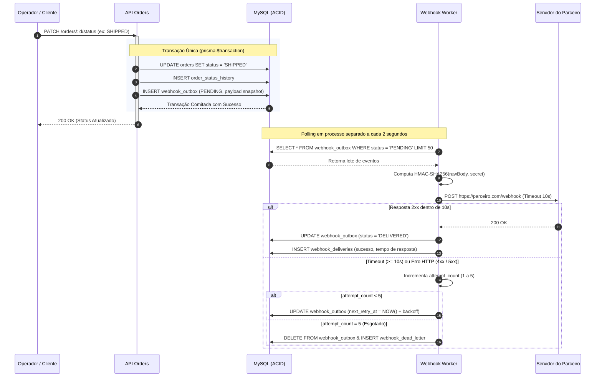

# RFC — Request for Comments: Arquitetura do Sistema de Webhooks de Notificação de Pedidos

## 1. Metadados
- **Autor(es):** Larissa (Tech Lead)
- **Status:** Proposta Aberta para Revisão
- **Data:** 2026-10-11
- **Revisores:**
  - Larissa (Tech Lead — Condução Técnica e Arquitetura)
  - Marcos (Product Manager — Requisitos de Negócio e SLAs com Parceiros)
  - Bruno (Engenheiro Pleno — Domínio de Pedidos e Integração com Codebase)
  - Diego (Engenheiro Sênior — Infraestrutura, Plataforma e Resiliência)
  - Sofia (Engenheira de Segurança — Criptografia, Autenticação e Riscos)

---

## 2. Resumo Executivo (TL;DR)

Esta RFC submete para avaliação da equipe de engenharia a proposta técnica do **Sistema de Webhooks de Notificação de Pedidos** (*Outbound Webhooks*) para o Order Management System (OMS). A proposta visa atender à demanda urgente de clientes corporativos estratégicos (Atlas Comercial, MaxDistribuição e Nova Cargo), substituindo o modelo atual de consultas repetitivas de alta frequência (*polling* em `GET /orders`) por um mecanismo ativo, seguro e assíncrono de notificações em tempo real sempre que o status de um pedido sofrer transição.

A arquitetura proposta apoia-se em quatro pilares fundamentais:
1. **Consistência Transacional Estrita via Transactional Outbox no MySQL:** A gravação da intenção do evento é atomicamente acoplada à transação SQL de alteração do pedido (`OrderService.changeStatus`), garantindo que nenhum evento seja perdido ou gerado sem commit correspondente.
2. **Processamento Assíncrono Desacoplado via Worker Dedicado:** Um processo Node.js autônomo (`src/worker.ts`) consome eventos em lotes curtos a cada 2 segundos, executando requisições HTTP POST contra os endpoints cadastrados com timeout limite de 10 segundos.
3. **Segurança Corporativa e Assinatura Criptográfica HMAC-SHA256:** Cada endpoint possui chave secreta exclusiva com suporte a rotação gradual (janela de convivência de 24 horas), transporte obrigatório em HTTPS e cabeçalho `X-Signature` computado sobre o payload cru, acompanhado de `X-Timestamp` para mitigação de ataques de repetição.
4. **Resiliência com Backoff Exponencial e Dead Letter Queue (DLQ):** Escalonamento progressivo de 5 retentativas ao longo de ~15 horas, com segregação de falhas permanentes em tabela isolada (`webhook_dead_letter`) e suporte a reprocessamento manual via endpoint administrativo protegido por controle de acesso baseado em papel (`ADMIN`).

A estimativa de desenvolvimento é de 3 sprints de engenharia, incluindo uma janela mandatória de homologação de 2 dias úteis com a equipe de segurança antes do deploy em produção para fechamento até o fim do trimestre corrente.

---

## 3. Contexto e Problema

### O Cenário Atual
Atualmente, o OMS expõe APIs REST síncronas para gestão do ciclo de vida de compras. Clientes corporativos B2B necessitam sincronizar seus sistemas legados de ERP e WMS com as mudanças de estado dos pedidos (especialmente aprovações financeiras, despachos e entregas). Na ausência de um canal orientado a eventos, esses parceiros mantêm rotinas automatizadas que disparam requisições periódicas a cada poucos minutos no endpoint `GET /orders`.

### As Limitações da Abordagem Vigente
1. **Ineficiência Operacional e Sobrecarga de Infraestrutura:** Mais de 80% das requisições recebidas em `GET /orders` retornam conjuntos idênticos de dados (sem alterações), gerando custo desnecessário de CPU, largura de banda e pool de conexões do MySQL.
2. **Latência de Sincronização Indesejada:** Atualizações logísticas críticas ficam retidas entre os ciclos de consulta dos clientes, introduzindo atrasos de minutos em rotinas de separação e expedição de mercadorias.
3. **Risco Comercial Eminente (*Churn*):** O principal parceiro corporativo da empresa (**Atlas Comercial**) formalizou que a disponibilização de notificações em tempo real (latência abaixo de 10 segundos) até o fechamento do trimestre (novembro) é condição indispensável para a manutenção do contrato de prestação de serviços.

### Premissas e Restrições Arquiteturais
- **Restrição de Infraestrutura:** A equipe de engenharia e operações é enxuta. A solução deve reaproveitar a infraestrutura existente de MySQL 8.0 e Node.js/TypeScript, sem dependência de novos clusters de mensageria dedicada (Kafka, Redis Cluster ou RabbitMQ).
- **Integridade Transacional Inegociável:** Não é tolerável em hipótese alguma que um pedido tenha seu status alterado no OMS sem que a notificação seja enfileirada, ou que um evento seja disparado para uma transação que sofreu rollback.
- **Isolamento de Falhas:** Instabilidades, indisponibilidades prolongadas ou lentidão nos servidores dos clientes parceiros nunca devem afetar a disponibilidade da API de pedidos ou reter threads de atendimento aos usuários humanos.

---

## 4. Proposta Técnica

### 4.1 Visão Geral da Arquitetura
A arquitetura propõe a divisão da solução em dois contextos de execução totalmente desacoplados:

1. **Plano de Inserção Transacional (API REST):**
   - Integrado ao método `changeStatus` da classe `OrderService` (`src/modules/orders/order.service.ts`).
   - A closure de transação `this.prisma.$transaction` atualiza o pedido, registra o histórico e invoca a função `publishWebhookEvent(tx, order, from, to)`.
   - Caso existam webhooks ativos cadastrados para aquele cliente e interessados naquele status, a função insere a linha na tabela `webhook_outbox` com status `PENDING` e um snapshot JSON pré-renderizado.

2. **Plano de Despacho e Resiliência (Worker Assíncrono):**
   - Executado em processo Node.js dedicado (`src/worker.ts`), desacoplado da API Express.
   - Opera em loop de consulta (*polling*) no banco a cada 2 segundos, processando lotes de até 50 eventos ordenados por `created_at ASC`.
   - Efetua a assinatura criptográfica HMAC-SHA256, injeta cabeçalhos de controle (`X-Event-Id`, `X-Webhook-Id`, `X-Timestamp`, `X-Signature`) e dispara a chamada HTTP POST com timeout rígido de 10 segundos.
   - Em caso de falha (status diferente de 2xx ou timeout), agenda a próxima retentativa seguindo recuo exponencial ou transfere o registro para a tabela `webhook_dead_letter` após a 5ª tentativa falha.

### 4.2 Diagrama Arquitetural de Alto Nível

```mermaid
flowchart TD
    subgraph ClienteAPI["Clientes e Operadores"]
        AppClient["Sistemas Externos / Usuários"]
    end

    subgraph API_Process["Processo 1: API HTTP (src/server.ts)"]
        OrderRoutes["Rotas de Pedidos"]
        OrderSvc["OrderService.changeStatus()"]
        WebhookRoutes["CRUD Webhooks & Replay DLQ"]
        AuthMiddleware["authenticate & requireRole('ADMIN')"]
    end

    subgraph Database["MySQL 8.0 (Prisma ORM)"]
        TableOrders[("orders & order_status_history")]
        TableOutbox[("webhook_outbox (status: PENDING)")]
        TableDLQ[("webhook_dead_letter (Falhas Finais)")]
        TableDeliveries[("webhook_deliveries (Auditoria 100 rec)")]
    end

    subgraph Worker_Process["Processo 2: Worker Assíncrono (src/worker.ts)"]
        WorkerLoop["Polling Loop (a cada 2s)"]
        Signer["Criptografia HMAC-SHA256"]
        Dispatcher["HTTP Client (Timeout 10s)"]
        RetryManager["Agendador de Backoff Exponencial"]
    end

    subgraph Parceiros["Receptores dos Parceiros B2B"]
        PartnerAtlas["Atlas Comercial (HTTPS)"]
        PartnerMax["MaxDistribuição (HTTPS)"]
        PartnerNova["Nova Cargo (HTTPS)"]
    end

    AppClient -->|PATCH /orders/:id/status| OrderRoutes
    OrderRoutes --> OrderSvc
    OrderSvc -->|1. Transação Atômica ACID| TableOrders
    OrderSvc -->|2. Inserção na mesma transação| TableOutbox

    WorkerLoop -->|Polling a cada 2s (LIMIT 50)| TableOutbox
    WorkerLoop --> Signer
    Signer --> Dispatcher
    Dispatcher -->|POST HTTPS com Headers| PartnerAtlas
    Dispatcher -->|POST HTTPS com Headers| PartnerMax
    Dispatcher -->|POST HTTPS com Headers| PartnerNova

    Dispatcher -->|Sucesso 2xx| TableDeliveries
    Dispatcher -->|Falha / Timeout| RetryManager
    RetryManager -->|Retentativas 1 a 5| TableOutbox
    RetryManager -->|Exaustão > 5 tentativas| TableDLQ

    AppClient -->|POST /admin/.../replay| WebhookRoutes
    WebhookRoutes --> AuthMiddleware
    AuthMiddleware -->|Reinsere evento como PENDING| TableOutbox
```

### 4.3 Fluxo Geral de Funcionamento



### 4.4 Estratégia de Desacoplamento e Resiliência
- **Garantia At-Least-Once com Idempotência:** Toda chamada HTTP propaga o cabeçalho `X-Event-Id` preenchido com UUID v4 imutável, permitindo ao parceiro desduplicar requisições em sua base.
- **Escalonamento de Backoff:** As retentativas respeitam os intervalos definidos na ADR-002 (1m, 5m, 30m, 2h, 12h), conferindo tolerância a quedas prolongadas sem penalizar o throughput.
- **Snapshot Imutável:** O payload JSON serializado na outbox congela os atributos do pedido no instante da mudança (`order_id`, `from_status`, `to_status`, `total_cents`), garantindo fidelidade temporal mesmo se transições subsequentes ocorrerem.
- **Padrão de Erros e Logs:** Todas as falhas geram logs estruturados no padrão Pino em JSON com prefixo de domínio `WEBHOOK_*`.

---

## 5. Alternativas Consideradas

A equipe deliberou extensivamente sobre abordagens técnicas alternativas durante o alinhamento de arquitetura. Abaixo registram-se as principais opções descartadas:

### 5.1 Mensageria Externa Pesada (Apache Kafka / Redis Streams / RabbitMQ)
- **Descrição da Abordagem:** Publicar mensagens em um cluster de mensageria externa imediatamente após a mudança do pedido, consumindo eventos através de filas distribuídas e workers desacoplados.
- **Por que foi Descartada:** Descartada formalmente por Larissa e Diego ([09:07]). Introduzir um cluster dedicado de mensageria adicionaria custos de infraestrutura substanciais, complexidade operacional desnecessária para uma equipe enxuta e a necessidade de coordenar transações distribuídas (Dual Write Problem) entre o commit do banco relacional e a publicação no broker.
- **Trade-off:** Perde-se a reatividade em submilisegundos nativa de brokers pub/sub orientados a eventos, mas ganha-se garantia atômica trivial dentro do MySQL sem novos pontos únicos de falha operacional.

### 5.2 Disparo HTTP Síncrono no Fluxo do Pedido (`OrderService`)
- **Descrição da Abordagem:** Disparar a requisição HTTP POST para o endpoint do cliente diretamente dentro do método síncrono `OrderService.changeStatus`.
- **Por que foi Descartada:** Descartada por Bruno e Larissa ([09:04]). A transação de pedidos já realiza múltiplas operações (atualização de estoque, inserção de histórico). Um disparo HTTP síncrono faria a requisição do OMS aguardar a resposta do servidor do parceiro. Caso o cliente sofresse lentidão ou estivesse fora do ar, a transação ficaria aberta prendendo conexões do banco, ou abortaria indevidamente a atualização de pedidos legítimos.
- **Trade-off:** Evitaria a criação de tabelas auxiliares de outbox e rotinas de polling, mas degradaria drasticamente a disponibilidade e a latência de ponta a ponta da API principal de pedidos.

### 5.3 Garantia Estrita de Entrega *Exactly-Once* Bilateral
- **Descrição da Abordagem:** Implementar transações distribuídas coordenadas bilateralmente (Two-Phase Commit ou consenso distribuído) para assegurar que nenhuma notificação seja jamais enviada mais de uma vez.
- **Por que foi Descartada:** Descartada por Diego e Sofia ([09:25]). Em ambientes de internet aberta sob HTTP contra clientes heterogêneos, implementar *exactly-once* é praticamente inviável e impraticável, exigindo acoplamento bilateral extremo. Os principais ecossistemas do mercado (Stripe, GitHub) operam sob *at-least-once* delegando a idempotência ao cabeçalho `X-Event-Id`.
- **Trade-off:** O consumidor precisa manter controle de deduplicação em sua aplicação, mas o OMS obtém máxima simplicidade, alta escalabilidade e tolerância a quebras de rede.

---

## 6. Questões em Aberto e Próximos Passos

Durante a deliberação técnica, três pontos foram identificados como relevantes, porém explicitamente postergados ou mantidos em aberto para observação empírica:

- **Questão 1: Rate Limiting de Saída por Cliente Parceiro (*Outbound Throttling*)**  
  *Contexto:* Levantado por Diego ([09:38]). Caso um cliente corporativo realize atualizações massivas de centenas de pedidos em um único minuto (ex.: importação em lote), o worker disparará centenas de chamadas simultâneas contra o servidor do cliente, correndo o risco de derrubar o receptor por saturação.  
  *Decisão de Alinhamento:* A equipe optou por não introduzir limitadores de vazão na v1. O comportamento será monitorado em produção através de telemetria; caso parceiros reportem sobrecarga, implementaremos enfileiramento com taxa máxima (*leaky bucket* ou semáforo por `customer_id`) na v2.

- **Questão 2: Notificações de Alerta por E-mail em Falhas Consecutivas**  
  *Contexto:* Levantado por Marcos ([09:37]). Questionou-se a possibilidade de disparar e-mails automáticos para o time técnico do parceiro caso um webhook falhe repetidamente por 3 vezes seguidas.  
  *Decisão de Alinhamento:* Descartado do escopo inicial pela Tech Lead Larissa. O disparo de e-mails adiciona complexidade de integração com provedores SMTP/transacionais e será reavaliado após a medição de métricas de volume e taxa de conversão da DLQ em produção.

- **Questão 3: Escala Horizontal Multi-Worker e Ordenação Global de Eventos**  
  *Contexto:* Levantado por Larissa e Bruno ([09:12]). O modelo de worker único garante ordenação cronológica estrita por `order_id` com base no `created_at`. No entanto, se o volume de pedidos crescer e demandar múltiplos processos workers em paralelo, haverá risco de condições de corrida e entrega fora de ordem para o mesmo pedido.  
  *Decisão de Alinhamento:* Mantido como premissa consciente de limitação da v1. Caso seja necessário escalar horizontalmente no futuro, será adotado particionamento consistente por hash de `order_id` ou locks pessimistas (`SELECT ... FOR UPDATE SKIP LOCKED`) na leitura do banco.

---

## 7. Impactos e Riscos Técnicos

### Impacto em Sistemas Existentes
1. **Modelagem de Dados (Prisma ORM):**
   - Criação de 4 novas tabelas em `prisma/schema.prisma`: `WebhookEndpoint`, `WebhookOutbox`, `WebhookDeadLetter` e `WebhookDelivery`.
   - Adição de índices compostos em `(status, created_at)` para garantir que as buscas de polling executem em milissegundos sem *table scan*.
2. **Método Central de Pedidos (`OrderService.changeStatus`):**
   - Extensão cirúrgica da transação `this.prisma.$transaction` para invocar a inserção na outbox, mantendo atomicidade absoluta.
3. **Rotina de Deploy e Infraestrutura:**
   - Criação do script de entrada `src/worker.ts` e configuração de execução no `package.json` (`npm run worker`), demandando provisionamento de um processo ou container Node.js dedicado em homologação e produção.

### Riscos Arquiteturais e Mitigações

| Risco Técnico | Probabilidade | Impacto | Estratégia de Mitigação Adotada |
| :--- | :--- | :--- | :--- |
| **Contenção no MySQL por Polling Contínuo** | Baixa | Médio | Consultas estritamente indexadas por status e data com lotes curtos (`LIMIT 50`) e intervalo de 2 segundos. Política de expurgo arquivará eventos entregues com mais de 30 dias. |
| **Bloqueio do Worker por Clientes Lentos** | Média | Alto | Configuração de timeout de conexão e leitura rígido de **10 segundos** em todas as requisições HTTP emitidas pelo worker. |
| **Vazamento de Segredo Criptográfico por Parceiro** | Média | Alto | Chave exclusiva por endpoint (sem chave global compartilhada) e disponibilização de endpoint de rotação gradual com tolerância de 24 horas (`POST /webhooks/:id/rotate-secret`). |
| **Reprocessamento Desordenado de DLQ** | Baixa | Médio | Restrição do endpoint de replay estritamente a administradores (`UserRole = ADMIN`), exigindo identificação de autoria e auditoria em log estruturado. |

---

## 8. Decisões Relacionadas (ADRs)

A fundamentação detalhada de cada escolha isolada encontra-se documentada nas seguintes Architecture Decision Records:

- [ADR-001 - Padrão Transactional Outbox Persistido no MySQL Existente](adrs/ADR-001-outbox-no-mysql.md): Justifica a garantia de atomicidade ACID entre pedidos e eventos sem introdução de brokers de mensageria externa.
- [ADR-002 - Política de Retentativas com Backoff Exponencial Escalonado e Tabela de Dead Letter Queue (DLQ)](adrs/ADR-002-politica-retry-backoff-dlq.md): Formaliza a política de 5 retentativas ao longo de 15 horas e a separação física da DLQ.
- [ADR-003 - Autenticação Criptográfica com HMAC-SHA256, Secret Única por Endpoint e Rotação Gradual](adrs/ADR-003-autenticacao-hmac-sha256.md): Detalha a assinatura de payloads, prevenção de replay attacks e o período de tolerância de 24 horas para rotação.
- [ADR-004 - Garantia de Entrega At-Least-Once com Desduplicação Idempotente via Cabeçalho X-Event-Id](adrs/ADR-004-entrega-at-least-once-idempotencia.md): Estabelece a responsabilidade de desduplicação pelo receptor através de UUID v4 padronizado.
- [ADR-005 - Worker Desacoplado em Processo Node.js Separado com Polling Periódico](adrs/ADR-005-worker-processo-separado-polling.md): Define o isolamento do despachante em processo independente com ciclo de busca a cada 2 segundos e timeout de 10 segundos.
- [ADR-006 - Reuso dos Padrões Arquiteturais Existentes (Módulos, AppError, Pino, Middleware de Erro e Prisma ORM)](adrs/ADR-006-reuso-padroes-codigo-existente.md): Estabelece a adesão irrestrita aos padrões corporativos da codebase e prefixo `WEBHOOK_*`.
- [ADR-007 - Snapshot Imutável do Payload no Momento da Inserção na Outbox](adrs/ADR-007-snapshot-payload-insercao-outbox.md): Garante a fidelidade histórica do evento congelado na inserção da outbox e restringe o payload a 64 KB.
